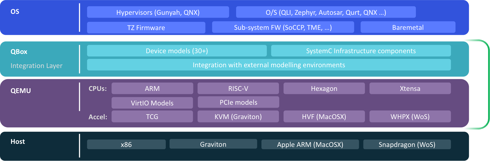

# QBox

QBox is a SystemC/QEMU co-simulation framework for virtual-platform development. It integrates QEMU into SystemC through TLM-2.0 and combines processor and device models with SystemC components. Supported processor families include ARM, RISC-V, and Hexagon.

**Featured:** [Qualcomm Dragonwing™ Virtual Platform](platforms/dragonwing/README.md) · [Competition](docs/competition/COMPETITION_SPLASH.md)

## Documentation

Browse the [documentation hub](docs/README.md) for build, platform, configuration, component, library, monitor and debugging, networking, Python, plugin, and competition guides.

## Quick start

For the Ubuntu 22.04/24.04 CI-configured preset recipe, install dependencies, then configure, build, and test:

```bash
sudo scripts/install_dependencies.sh
cmake --preset gcc -DLIBQEMU_TARGETS="aarch64;hexagon"
cmake --build --preset gcc --parallel
ctest --preset gcc
```

These commands match the CI configuration. GitHub Actions is currently disabled, so this recipe has not been run in CI. Preset commands require CMake 3.21 or newer.

## Architecture

Guest software runs on the modeled platform. QBox connects QEMU CPU/device models to SystemC TLM-2.0 models. Lua and CCI configure the components, parameters, and connections.



QEMU can use TCG or host-specific acceleration, depending on the build and host. The diagram is a high-level overview, not a tested support matrix; see the [build guides](docs/building.md) and [platform guides](docs/README.md) for configuration requirements.

## Building

See the [Building QBox guide](docs/building.md) for platform prerequisites, support status, and configure, build, test, and install instructions.

## C++ Standard

QBox requires C++17 and is compatible with SystemC versions from
SystemC 2.3.1a.

## Contributing

See [CONTRIBUTING.md](CONTRIBUTING.md).

## License

See [LICENSE](LICENSE).
