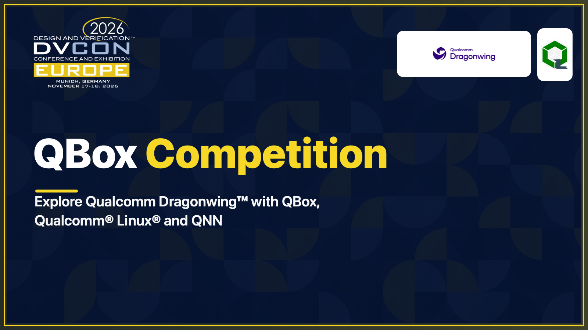

# QBox Competition

## Build it. Run it. Show it.

**Kicking off at [DVCon Europe 2026](https://dvcon-europe.org/).**

## The challenge

Using the **Qualcomm Dragonwing™ Virtual Platform in QBox**, demonstrate a use case with **Qualcomm® Linux® and Qualcomm Neural Network (QNN) models from the [Qualcomm® AI Hub](https://aihub.qualcomm.com/models)**. Explain what it does, how to run it, and show it working.

**Technologies:** Qualcomm Dragonwing™ · QBox · Qualcomm® Linux® · QNN

## Submit a 30-second video

Entries are judged on a **30-second video**. Send your video to [competition@dvcon-europe.org](mailto:competition@dvcon-europe.org).

**Prizes for the best entries:** Winners will receive [Arduino VENTUNO Q](https://www.arduino.cc/product-ventuno-q). *Where AI Takes Action* — The powerhouse for AI and robotics applications.

**Closing date:** 26 February 2027.

**Results:** Results will be announced at a SystemC Evolution Fika in March 2027.

QBox is open source, and contributions to QBox will also be considered by the judges.

### Useful links

- [QBox on GitHub](https://github.com/qualcomm/qbox)
- [DVCon Europe](https://dvcon-europe.org/)
- [SystemC events](https://systemc.org/events/scevents/)

**Competition rules are below.**

Competition rules

# Competition rules

## Entry

Using the Qualcomm Dragonwing™ Virtual Platform in QBox, demonstrate a use case with Qualcomm® Linux® and Qualcomm Neural Network (QNN) models from the [Qualcomm® AI Hub](https://aihub.qualcomm.com/models). Explain what it does, how to run it, and show it working. Entries are judged on a submitted 30-second video. Send the video to [competition@dvcon-europe.org](mailto:competition@dvcon-europe.org).

Individual and team entries are allowed. Entrants must get their collaborators' consent before naming them or submitting their work.

## Schedule

- **Closing date:** 26 February 2027.
- **Results:** Results will be announced at a SystemC Evolution Fika in March 2027.

## Prizes

Prizes for the best entries: Winners will receive [Arduino VENTUNO Q](https://www.arduino.cc/product-ventuno-q).

## Judging

Judges will consider relevance to the Qualcomm Dragonwing™ Virtual Platform in QBox and the Qualcomm® Linux® and QNN use case; functionality shown; clarity of the explanation; and creativity.

## Originality and third-party rights

Entries must be entrants' own original work. Use of models from the [Qualcomm® AI Hub](https://aihub.qualcomm.com/models) is encouraged.

## DVCon copyright form

An entry must be accompanied by a completed [DVCon copyright form](https://dvcon-europe.org/authors/speaker-resources-and-guidelines).

## Useful links

- [QBox on GitHub](https://github.com/qualcomm/qbox)
- [Arduino VENTUNO Q product page](https://www.arduino.cc/product-ventuno-q)
- [Qualcomm® AI Hub model catalog](https://aihub.qualcomm.com/models)
- [DVCon Europe](https://dvcon-europe.org/)
- [SystemC Events & History](https://systemc.org/events/scevents/)
- [SystemC Call for Presentations](https://systemc.org/events/cfp/)

For the full visual design, open the [HTML companion](COMPETITION_SPLASH.html) from a local copy or through GitHub Pages. GitHub's repository file view displays HTML source rather than rendering the page.

---

© Qualcomm Technologies, Inc. and/or its affiliated companies.

Snapdragon and Qualcomm branded products are products of Qualcomm Technologies, Inc. and/or its subsidiaries. Qualcomm patents are licensed by Qualcomm Incorporated.

Note: Certain services and materials may require you to accept additional terms and conditions before accessing or using those items.

References to "Qualcomm" may mean Qualcomm Incorporated, or subsidiaries or business units within the Qualcomm corporate structure, as applicable.

Qualcomm Incorporated includes our licensing business, QTL, and the vast majority of our patent portfolio. Qualcomm Technologies, Inc., a subsidiary of Qualcomm Incorporated, operates, along with its subsidiaries, substantially all of our engineering, research and development functions, and substantially all of our products and services businesses, including our QCT semiconductor business.

Materials that are as of a specific date, including but not limited to press releases, presentations, blog posts and webcasts, may have been superseded by subsequent events or disclosures.

Nothing in these materials is an offer to sell or license any of the services or materials referenced herein.
